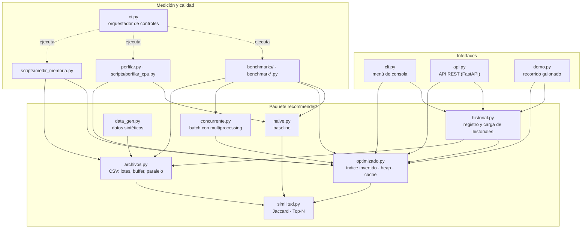

# 2. Arquitectura

El sistema es una **biblioteca** (`recommender/`) sin dependencias externas, rodeada por
**interfaces** delgadas (CLI, API, demo) y **herramientas** de medición y calidad. Las
interfaces nunca implementan lógica de negocio: delegan en el paquete.

## Diagrama de componentes



Las flechas indican "importa a". No hay ciclos: `similitud.py` es la base y no depende de
ningún otro módulo del proyecto.

## Módulos y responsabilidades

| Módulo | Responsabilidad | Depende de |
|---|---|---|
| `recommender/similitud.py` | Similitud de Jaccard, criterio de orden de vecinos (`clave_vecino`) y acumulación Top-N (`top_items`). Define el alias `Perfiles`. Es la única fuente de verdad del puntaje, compartida por ambas implementaciones. | — |
| `recommender/naive.py` | Recomendador **baseline**: compara contra todos los usuarios y ordena la lista completa. Sirve de referencia de correctitud y de rendimiento. | `similitud` |
| `recommender/optimizado.py` | Recomendador **optimizado**: índice invertido ítem→usuarios, Top-K con heap, memoización de similitudes y caché de recomendaciones con invalidación por versiones. | `similitud` |
| `recommender/historial.py` | Alta/actualización de usuarios y conversión de historiales (memoria o archivo) en perfiles; los historiales se **suman** a las preferencias previas. | `optimizado`, `archivos`, `similitud` |
| `recommender/archivos.py` | E/S de historiales CSV grandes: escritura por lotes con buffer, lectura en streaming con generadores y procesamiento en paralelo por rangos de bytes. | `similitud` |
| `recommender/concurrente.py` | Recomendaciones en batch, secuencial y con `multiprocessing.Pool` (un recomendador por worker). | `optimizado`, `similitud` |
| `recommender/data_gen.py` | Datasets y eventos sintéticos reproducibles (semilla fija) para tests y benchmarks. | `archivos`, `similitud` |
| `api.py` | API REST: valida entradas con Pydantic, traduce errores a códigos HTTP y restringe la lectura de archivos al directorio de datos. | `fastapi`, `pydantic`, `historial`, `optimizado` |
| `cli.py` | Menú interactivo con despacho por diccionario (`OPCIONES`). | `historial`, `optimizado` |
| `demo.py` | Recorrido de las funcionalidades con datos chicos y legibles. | `historial`, `optimizado` |
| `ci.py` | Define y ejecuta todos los controles de calidad; lo usan el CI y los desarrolladores. | herramientas de `requirements-dev.txt` |

## Dependencias externas

| Dependencia | Uso | Dónde |
|---|---|---|
| Librería estándar de Python | Todo el motor (`heapq`, `multiprocessing`, `random`, `tracemalloc`…) | `recommender/` |
| FastAPI + Pydantic + Starlette | API REST y validación de entradas | `api.py` (ejecución) |
| Uvicorn | Servidor ASGI para la API | ejecución |
| httpx | Cliente HTTP de `fastapi.testclient` | pruebas |
| pytest, pytest-cov, pytest-benchmark | Pruebas, cobertura y benchmarks | desarrollo / CI |
| Ruff, pylint, mypy, Radon, Xenon, Lizard | Análisis estático, tipado y complejidad | desarrollo / CI |
| Bandit, pip-audit, gitleaks, CodeQL | Seguridad de código, dependencias y secretos | desarrollo / CI |
| pyinstrument, SnakeViz, py-spy | Profiling | desarrollo / CI |
| MkDocs, Material, mkdocstrings | Esta documentación | desarrollo / CI |

Las versiones exactas están fijadas en `requirements.txt` (ejecución) y `requirements-dev.txt`
(desarrollo), generados desde `requirements/*.in`. Ver [Instalación](instalacion.md).

## Estructura del repositorio

```text
recommender/            paquete del motor (sin dependencias externas)
api.py  cli.py  demo.py interfaces
tests/                  pruebas funcionales (pytest)
benchmarks/             benchmarks (pytest-benchmark), línea base y límites de memoria
scripts/                comparación de benchmarks, profiling y medición de memoria para el CI
ci.py                   orquestador de controles (local = CI)
docs/  mkdocs.yml       esta documentación
requirements/*.in       dependencias declaradas (rangos)
requirements*.txt       dependencias fijadas (lock)
seguridad/              excepciones documentadas de los escáneres
.github/                workflows de GitHub Actions y Dependabot
datos/                  único directorio que la API puede leer
calidad/  perfiles/     reportes históricos del segundo parcial
```
