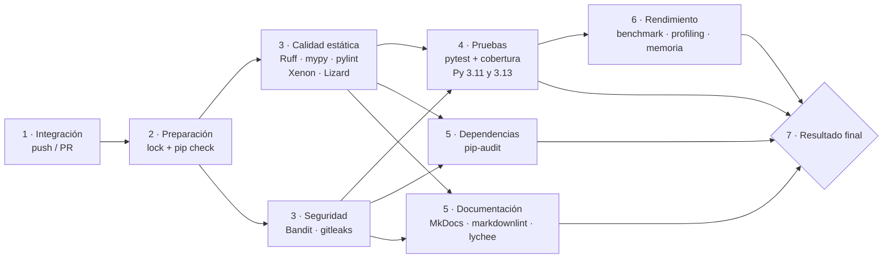

# Diseño del pipeline

Plataforma: **GitHub Actions** (`.github/workflows/ci.yml`). Se ejecuta en cada **push** y cada
**pull request** hacia `main`, y también a mano (*workflow_dispatch*). Si llega un push nuevo a
la misma rama, la corrida anterior se cancela.

## Etapas

| # | Job | Contenido | Depende de | Duración aprox. |
|---|---|---|---|---|
| 1 | — | Disparo por push/PR; revisión humana obligatoria en el PR | — | — |
| 2 | `preparacion` | Instala `requirements-dev.txt` (versiones fijadas), `pip check`, verifica que los lock files estén sincronizados | — | 1 min |
| 3 | `estatico` | `python ci.py estatico` | 2 | 1 min |
| 3 | `seguridad` | `python ci.py seguridad --estricto` + SARIF a *Code scanning* | 2 | 1 min |
| 4 | `pruebas` (matriz 3.11 / 3.13) | `python ci.py pruebas` | 3 | 1 min |
| 5 | `dependencias` | `python ci.py dependencias` | 3 | 1 min |
| 5 | `documentacion` | `python ci.py docs --estricto` | 3 | 1 min |
| 6 | `rendimiento` | `python ci.py rendimiento` | 4 | 2 min |
| 7 | `resultado` | Aprueba solo si **todos** los anteriores terminaron en `success` | todos | segundos |

Criterios de diseño:

- **Lo rápido primero**: el análisis estático tarda segundos y detecta la mayoría de los
  problemas; si falla, no se gasta tiempo en pruebas ni en mediciones.
- **Paralelismo donde no hay dependencia**: estático y seguridad corren juntos; pruebas,
  dependencias y documentación también.
- **Lo costoso al final**: benchmarks y memoria solo corren si las pruebas pasan (medir el
  rendimiento de código incorrecto no tiene sentido).
- **Un único status check**: la protección de rama requiere solo `7 · Resultado final`, que
  falla si cualquier job falló o fue cancelado. Agregar un job nuevo no obliga a tocar la
  configuración del repositorio.
- **Instalación reproducible**: cada job instala el mismo lock; la caché de pip se indexa por
  `requirements-dev.txt`.
- **Permisos mínimos**: `contents: read` por defecto; solo `seguridad` pide
  `security-events: write` para subir SARIF.

## Qué ocurre si un control falla

| Control | Condición de rechazo | Efecto |
|---|---|---|
| Pruebas | Una o más pruebas fallan | Job 4 en rojo → 6 no corre → 7 rechaza |
| Análisis estático | Ruff con hallazgos o pylint < 9,5 | Job 3 en rojo → 4, 5 y 6 no corren → 7 rechaza |
| Cobertura | < 90 % | Job 4 en rojo |
| Complejidad | CC > 10, > 50 NLOC o > 6 parámetros | Job 3 en rojo |
| Tipado | Cualquier error de mypy `--strict` | Job 3 en rojo |
| Seguridad | Bandit alta/≥ media, cualquier secreto, cualquier vulnerabilidad de dependencia | Job 3 o 5 en rojo |
| Documentación | `mkdocs --strict`, markdownlint o lychee fallan | Job 5 en rojo |
| Benchmark | Regresión normalizada > 50 % o speedup < 3x | Job 6 en rojo |
| Memoria | Pico > límite medido × 1,3 | Job 6 en rojo |

Dentro de cada job, `ci.py` **corre todos los controles de la etapa aunque uno falle**, para que
el reporte muestre todos los problemas juntos, y al final devuelve código 1 si alguno bloqueante
falló. Los controles marcados como informativos (reporte de Radon, reporte JSON de pip-audit)
aparecen como **AVISO** pero no rechazan.

## Reportes y artefactos

Cada job publica `reportes/` como artefacto (`reportes-estatico`, `reportes-seguridad`,
`reportes-pruebas-py3.11`, …) aunque haya fallado (`if: always()`), y escribe una tabla de
resultados en el resumen de la corrida (*Job summary*). El job 7 agrega la tabla final por job.

## Workflows complementarios

| Workflow | Cuándo | Qué hace |
|---|---|---|
| `docs.yml` | push a `main` | Construye la documentación y la publica en GitHub Pages |
| `codeql.yml` | push/PR a `main` y semanal | Análisis semántico de seguridad (CodeQL `security-extended`) |
| `dependabot.yml` | semanal | PRs de actualización de pip y de las GitHub Actions |
